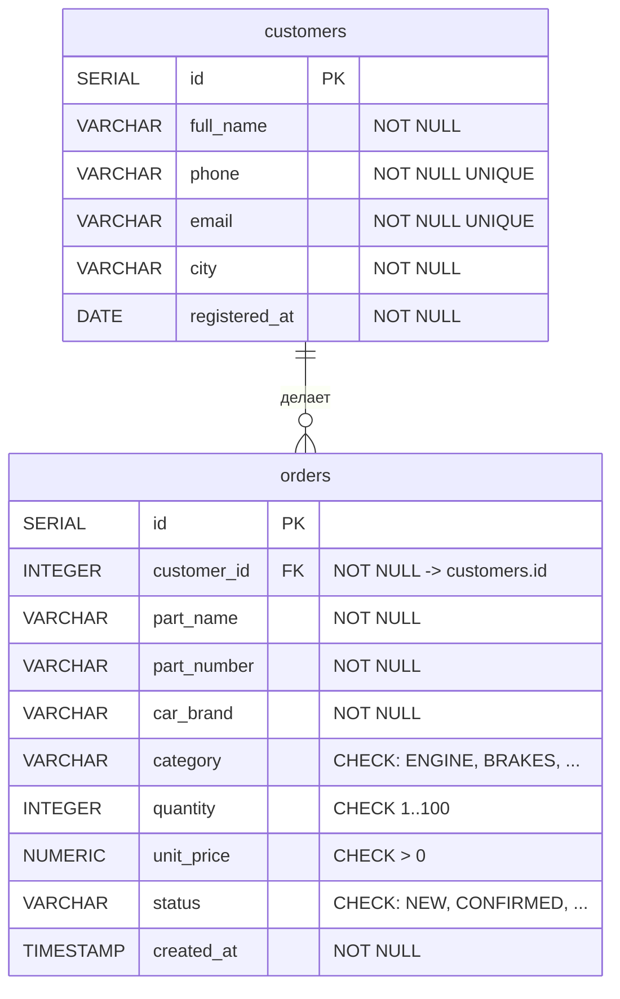

# ER-диаграмма базы данных `autoparts`

Картинка: [er-diagram.svg](er-diagram.svg) (открывается в любом браузере, можно вставить в отчёт).

Та же диаграмма в формате Mermaid (её можно вставить на https://mermaid.live и скачать PNG):

## Связь

`orders.customer_id → customers.id` — **один ко многим**: у одного клиента может быть сколько угодно заказов
(в том числе ни одного), а каждый заказ принадлежит ровно одному клиенту.

`ON DELETE RESTRICT` — база не даст удалить клиента, пока у него есть заказы.

## Ограничения

| Ограничение | Где | Зачем |
|-------------|-----|-------|
| PRIMARY KEY | `customers.id`, `orders.id` | уникальный номер каждой строки |
| FOREIGN KEY | `orders.customer_id` | заказ нельзя создать для несуществующего клиента |
| NOT NULL | все столбцы | обязательные поля не могут быть пустыми |
| UNIQUE | `customers.phone`, `customers.email` | два клиента не могут иметь один телефон или email |
| CHECK | `quantity`, `unit_price`, `category`, `status` | допустимые значения: количество 1–100, цена > 0, категория и статус только из списка |
